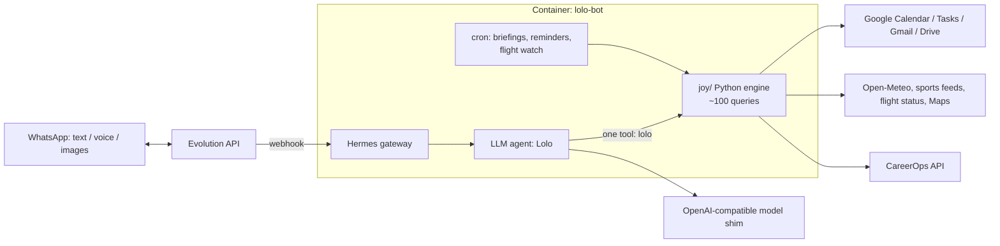

<div align="center">

# 🤖 Lolo: a personal-assistant agent on WhatsApp

### Calendar, tasks, email, Drive, flights, sports, contracts and an automated job-search pipeline, all from one chat

*A tool-using LLM agent with ~100 queries over Google Workspace and public APIs. It acts instead of chatting, and never claims something is done before the tool confirms it.*


</div>

---

## What is it?

**Lolo** is my personal assistant. I talk to it in a WhatsApp group (just me and the bot) or in DMs, with text or voice notes,
and it turns instructions into actions: schedule an event, create a task, draft an email, find a file, track a flight, write a
contract, or move forward my job-search pipeline.

## 💬 How it behaves

- **07:00 daily briefing**: weather, today's events by calendar, tasks and the next 3 days.
- **Natural-language instructions** such as "book the dentist tomorrow 3pm and invite Ana" become a calendar event in the right colored calendar, after a conflict check.
- **Status questions** about the job-search pipeline return the queue and what is waiting for approval.

## ✨ Capabilities

| Area | What it does | Modules |
|---|---|---|
| 📅 **Calendar** | Natural-language events across 5 color-coded calendars (personal, family, work, business, travel), conflict check, recurrence, reminders, invite rules per calendar | `agenda.py`, `google.py`, `pessoas.py` |
| ✅ **Tasks and lists** | Google Tasks with lists, due dates, local queue when Google is not connected | `google.py` |
| ✉️ **Email** | Read, search, draft, reply, attach, send, where **sending requires explicit confirmation** | `gmail.py` |
| 📂 **Drive, Docs, Sheets** | Search, read (with OCR for PDFs/images), create folders, save text, rename, move, trash | `drive.py`, `documentos.py` |
| 📄 **Contracts** | Simple or full contract drafts from a **fixed clause library**; the LLM only supplies data. CPF/CNPJ validation, revision and formatting | `contratos.py`, `contratos_clausulas.py` |
| 💼 **CareerOps** | Job-search and LinkedIn pipeline driven from WhatsApp: queue, approve/reject, comment, daily summary | `carreira.py` |
| ✈️ **Flights** | Live status from a public endpoint and **proactive WhatsApp alerts** when a monitored flight changes | `voos.py` |
| 🏟️ **Sports** | Fixtures, scores, standings and where to watch in Brazil, only free keyless sources | `esporte.py` |
| 🗺️ **Maps and weather** | Places/Routes lookups, Open-Meteo forecast (no key) | `maps.py`, `clima.py` |
| 🔗 **Link reader** | Safely reads tweets, GitHub, YouTube, web pages and PDFs (**SSRF protection**) and cross-references them with a map of my own systems to suggest improvements | `links.py`, `xtwitter.py`, `sistemas.py` |
| 🎨 **Media** | Image/meme generation sent back to the chat | `midia.py` |
| ⏰ **Reminders** | One-off, daily, weekly, monthly via a once-a-minute cron | `lembretes.py` |
| 🧠 **Model routing** | `auto` picks a fast/cheap model by default and escalates to stronger ones by task complexity or on request | `data/config.yaml` |

## 🏗️ Architecture



**Principles**

1. **Act, then confirm.** The agent never reports a result before the tool returns it. Failures are reported honestly.
2. **Read the verb.** *Save/archive* ≠ *edit* ≠ *create new*; when unsure between edit and create it edits, and "undo" stops everything and offers to trash what it created by mistake.
3. **Dangerous actions are gated.** Email is sent only after an explicit "send". Link fetching blocks private network ranges.
4. **LLM for language, code for facts.** Dates are resolved in code, contracts use a fixed clause library, validations (CPF/CNPJ) are deterministic.
5. **Tested offline.** Eight test suites cover recurrence, reminders, relative dates, email, contracts, documents, flights and Google reconnect logic.

## 📁 Layout

| Path | What |
|---|---|
| `joy/core.py` | query router for the `lolo` tool |
| `joy/*.py` | one module per capability (table above) |
| `ops/google_auth.py` | OAuth flow to connect Calendar/Tasks/Gmail/Drive |
| `tests/` | offline tests |
| `docker-compose.yml` · `data/config.yaml` · `data/.env.example` | deployment |

## 🚀 Run it

Needs Docker, an [Evolution API](https://github.com/EvolutionAPI/evolution-api) instance, an OpenAI-compatible LLM endpoint, the
[Hermes Agent](https://hub.docker.com/r/nousresearch/hermes-agent) image and a Google OAuth client (Calendar, Tasks, Gmail, Drive).

```bash
git clone https://github.com/pjaragao/lolo-bot.git && cd lolo-bot
cp data/.env.example data/.env           # Evolution, model, Google Maps, link tokens
python3 ops/google_auth.py               # one-time OAuth consent
docker compose up -d
```

Tests (offline):

```bash
for t in tests/test_*.py; do JOY_DIR=$PWD/joy HERMES_HOME=/tmp/lolo-test python3 $t; done
```

> The persona prompt, personal data, calendar identifiers and credentials are intentionally **not** in this repository.
> Calendar ids in `joy/google.py` are placeholders.

---

<div align="center">

Built by **Paulo Aragão Jr** · [GitHub](https://github.com/pjaragao) · related: [sie-joy-bot](https://github.com/pjaragao/sie-joy-bot) · [luisa-bot](https://github.com/pjaragao/luisa-bot) · [mr-irrelevant](https://github.com/pjaragao/mr-irrelevant)

</div>
